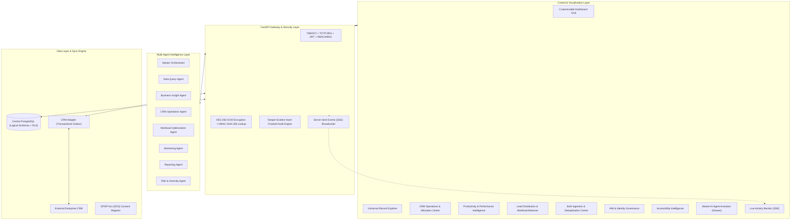

# Centralized Real Estate Intelligence & Operations Command Center

A high-performance **AI-Powered Real Estate Enterprise Operations Command Center** designed for management to **Observe, Analyze, Decide, Execute, and Monitor** business operations across regions, projects, and sales teams from a unified interface.

Built for **800,000+ lead records**, featuring **AES-256-GCM field encryption**, **HMAC-SHA-256 deterministic lookup**, **DPDP Act (2023) consent records**, **tamper-evident audit trails**, and **bidirectional CRM synchronization**.

---

## 🌟 Architectural Overview



---

## 🚀 Quick Run (No Docker)

### 1. Start Backend API & Command Center

```bash
.\venv\Scripts\python -m uvicorn backend.app.main:app --port 8000 --reload
```

Open your browser at **http://localhost:8000**.

### 2. Pre-Seeded Synthetic Accounts (Password: `AdminPass@2026`)

| Role | Email | Scope |
| :--- | :--- | :--- |
| **Super Admin** | `admin@demo.local` | Full platform & audit visibility, unmasked PII |
| **Management** | `mgmt@demo.local` | Enterprise portfolio, workload, and CRM approvals |
| **Regional Manager** | `south.mgr@demo.local` | South Region operations (Bengaluru Hub) |
| **Regional Manager** | `north.mgr@demo.local` | North Region operations (Delhi NCR) |
| **Auditor** | `auditor@demo.local` | Read-only access to tamper-evident audit logs |

---

## 🐳 Run with Docker Compose (PostgreSQL + Redis + Nginx)

```bash
cp .env.example .env
docker compose up --build
```

Access the reverse proxy at **http://localhost** (port 80).

---

## 🧪 Automated Quality Assurance & Tests

Run the full automated test suite covering PBKDF2 authentication, JWT tokens, cryptographic audit chain integrity, executive overview calculations, server-side paginated record explorer, regional ABAC scoping, workload optimization heuristic allocation, idempotency, AI orchestrator intent classification, AES-256-GCM encryption, HMAC deterministic lookup, bulk ingestion, and DPDP Act consent:

```bash
$env:PYTHONPATH="."; .\venv\Scripts\pytest backend\tests -v
```

---

## 🔑 Key Enterprise Modules Implemented

1. **Executive Overview**: Real-time leads, active projects, pipeline valuation ₹Cr, closed revenue, conversion rates, and overdue tasks.
2. **Universal Record Explorer**: Server-side paginated queries across Customers, Leads, Projects, Units, and Tasks with role-aware data masking.
3. **CRM Operations & Intelligent Allocation**: Direct lead assignment, preview workflows, explainable AI allocation heuristics, and CRM API sync.
4. **Sales Intelligence**: Pipeline stage funnels, marketing acquisition channels, and project-wise conversion rates.
5. **Productivity & Performance Intelligence**: Task completion rate (%), lead response time (hrs), follow-up compliance (%), resolution time (days), and composite productivity scores.
6. **Distribution & Automated Workload Balancer**: Geographic distribution, channel breakdown, unassigned lead queue, overload flags, and automated 1-click rebalancing recommendations.
7. **Bulk Ingestion & Deduplication Center (800k Records Scale)**: CSV/Excel landing zone, SHA-256 checksum verification, AES-256-GCM encryption, HMAC-SHA-256 deduplication, and candidate resolution queue.
8. **IAM & Security Governance**: User directory, role/permission breakdown, MFA enrollment status, failed logins (7d), and locked accounts.
9. **Accessibility Intelligence**: 24-hour access heatmaps, cross-region boundary breach alerts, and off-hour access detection.
10. **Tamper-Evident Hash-Chained Audit Engine**: Cryptographic previous-hash chaining verifying log integrity.
11. **Live Operations Monitor**: Real-time Server-Sent Events (SSE) stream broadcasting all system events.
12. **Master AI Agent Assistant**: 8 specialized AI agents supporting natural-language data queries, business insights, workload balancing, and CRM operations.
