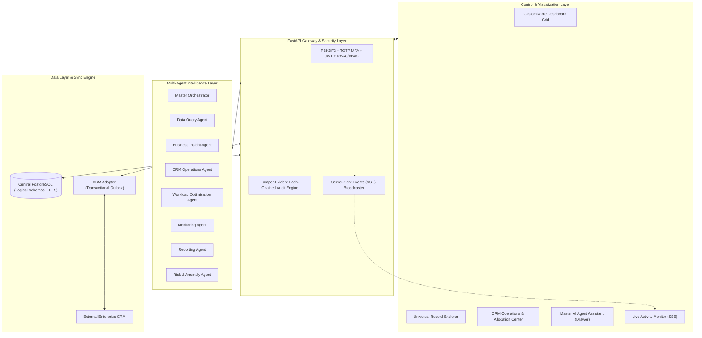

# Centralized Real Estate Intelligence & Operations Command Center

A high-performance **AI-Powered Real Estate Enterprise Operations Command Center** designed for management to **Observe, Analyze, Decide, Execute, and Monitor** business operations across regions, projects, and sales teams from a unified interface.

---

## 🌟 Architectural Overview



---

## 🚀 Quick Run (No Docker)

### 1. Start Backend API & Command Center
```bash
python -m uvicorn backend.app.main:app --port 8000 --reload
```
Open your browser at **http://localhost:8000**.

### 2. Pre-Seeded Synthetic Accounts (Password: `AdminPass@2026`)
| Role | Email | Scope |
| :--- | :--- | :--- |
| **Super Admin** | `admin@demo.local` | Full platform & audit visibility, unmasked PII |
| **Management** | `mgmt@demo.local` | Enterprise portfolio, workload, and CRM approvals |
| **Regional Manager** | `south.mgr@demo.local` | South Region operations (Bengaluru Hub) |
| **Regional Manager** | `north.mgr@demo.local` | North Region operations (Delhi NCR) |
| **Auditor** | `auditor@demo.local` | Read-only access to tamper-evident audit logs |

---

## 🐳 Run with Docker Compose (PostgreSQL + Redis + Nginx)

```bash
cp .env.example .env
docker compose up --build
```
Access the reverse proxy at **http://localhost** (port 80).

---

## 🧪 Automated Quality Assurance & Tests

Run the full automated test suite covering PBKDF2 authentication, JWT tokens, cryptographic audit chain integrity, executive overview calculations, server-side paginated record explorer, regional ABAC scoping, workload optimization heuristic allocation, idempotency, and AI orchestrator intent classification:

```bash
python -m pytest backend/tests/test_platform.py -v
```

---

## 🔑 Key Features Implemented

1. **Observe**:
   - Executive Overview with live active leads, active projects, pipeline valuation, closed revenue, conversion rates, and overdue tasks.
   - Universal Filters Bar synchronizing Region, Lead Stage, Priority, and Project across all widgets.
2. **Analyze**:
   - Sales Intelligence funnel and marketing channel breakdown.
   - Project-wise conversion and regional comparison tables.
   - Team capacity and task compliance meters with automated overload detection.
3. **Decide**:
   - Master AI Agent Orchestrator with 8 specialized agents:
     1. Master Orchestrator (Intent classification, scope checking, tool routing)
     2. Data Query Agent (Natural language to authorized database queries)
     3. Business Insight Agent (Conversion bottlenecks & top project identification)
     4. CRM Operations Agent (Task suggestions & lead status coordination)
     5. Workload Optimization Agent (Lead allocation heuristics)
     6. Monitoring Agent (Operational health & CRM sync status)
     7. Reporting Agent (Periodic performance summaries)
     8. Risk & Anomaly Agent (Disproportionate workload & access alerts)
4. **Execute**:
   - Lead Allocation Preview evaluating regional match, capacity, and luxury specialization.
   - Manager Approval gate before dispatching assignments to CRM.
   - Idempotent batch execution with per-record result tracking.
5. **Monitor**:
   - Live Activity Center with Server-Sent Events (SSE) streaming real-time operations.
   - CRM Bidirectional Sync Engine with Transactional Outbox, Inbound Webhook HMAC verification, and Conflict Detection.
   - Tamper-Evident SHA-256 Hash-Chained Audit Logs with one-click cryptographic integrity verification.
