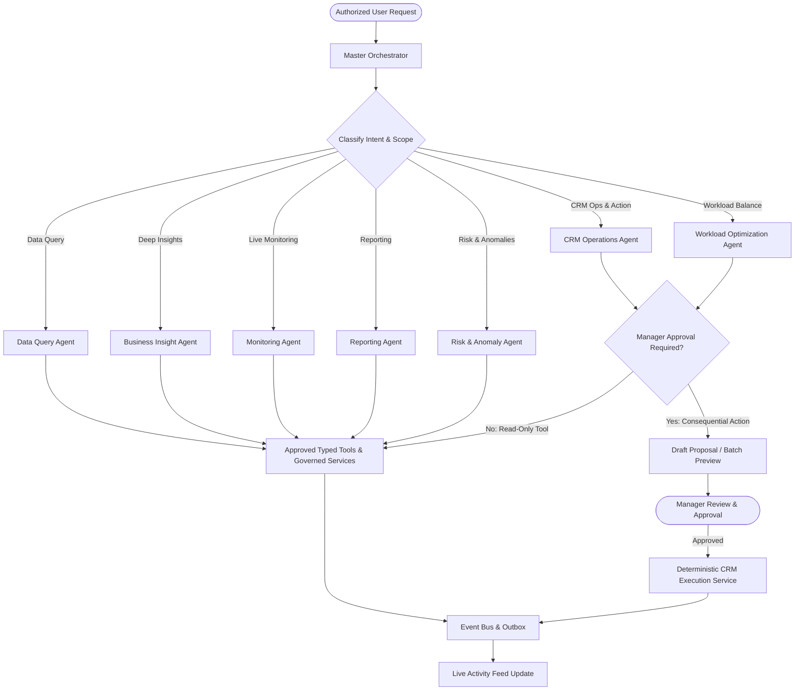

# Multi-Agent Architecture & Governance Specification

## 1. Multi-Agent Ecosystem
The system coordinates 8 specialized AI agents governed by strict access boundaries, structured Pydantic schemas, and deterministic tool bindings. Agents cannot execute arbitrary shell commands, raw unconstrained SQL queries, or direct external network calls.

## 2. Specialized Agent Roles & Capabilities

### Agent 1: Master Orchestrator
- **Responsibility**: Interprets requests, categorizes intent (`query`, `analysis`, `action`, `monitoring`), checks user role/region permissions, dispatches sub-tasks to specialized agents, aggregates results, and logs the execution session.

### Agent 2: Data Query Agent
- **Responsibility**: Translates natural language questions into authorized database query filters. Strictly applies user's regional/role constraints. Returns exact records with database references.

### Agent 3: Business Insight Agent
- **Responsibility**: Analyzes performance trends, calculates conversion rates across projects and marketing sources, identifies project bottlenecks, and provides explainable insights supported by data references.

### Agent 4: CRM Operations Agent
- **Responsibility**: Manages lead actions, follow-up scheduling, task creations, and status transitions. Produces batch proposals with reasons for each change.

### Agent 5: Workload Optimization Agent
- **Responsibility**: Evaluates employee capacity, project familiarity, regional assignment, pending task backlogs, and conversion efficiency. Recommends optimal lead distribution without ever bypassing human manager approval.

### Agent 6: Monitoring Agent
- **Responsibility**: Tracks CRM sync latency, outbox queue health, error spikes, and recent operational events.

### Agent 7: Reporting Agent
- **Responsibility**: Synthesizes periodic management summaries, employee productivity rankings, and inventory reports in structured JSON/CSV.

### Agent 8: Risk & Anomaly Agent
- **Responsibility**: Detects abnormal patterns (e.g. sudden batch reassignments, unusual authentication spikes, outbox synchronization failures, duplicate leads).
